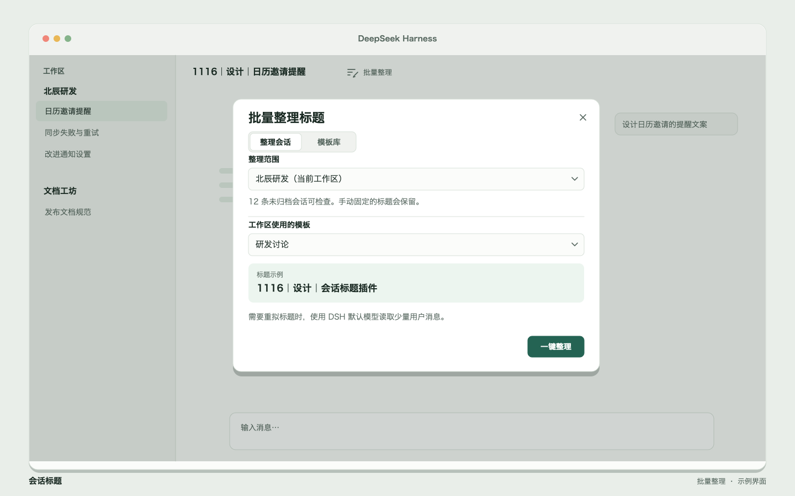

# Conversation Titles for DSH

[简体中文](README.md)

A DeepSeek Harness plugin for workspace-based conversation titles. It can format titles during normal conversations, organize unarchived sessions in bulk, and share named title templates across workspaces.

Tested with **DSH 0.2.2-rc.3**. Install into the Desktop profile:

```sh
dsh plugin --profile desktop add dsh-conversation-title --registry=https://registry.npmjs.org
```

Reopen DSH and choose **批量整理** (Organize titles) in the conversation header. Choose the current workspace, another workspace, or all workspaces. The **模板库** (Template library) tab lets you copy the built-in template, choose a name, and edit its format and type options. Apply a saved template to each workspace that should use it.

Automatic title formatting is enabled by default in the current profile. It uses a prompt-based tool call and may wait for another substantive turn. A batch only considers eligible unarchived sessions, and it preserves titles the host marks as user-set.



[CC0 1.0 Universal](LICENSE)
