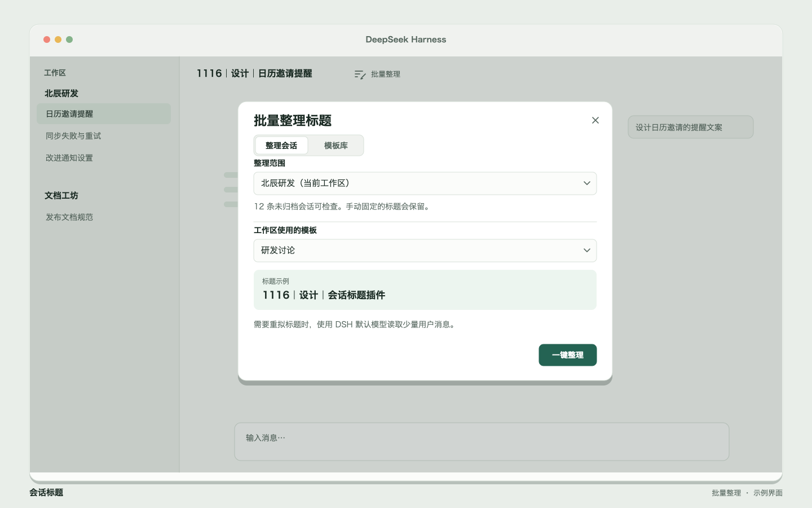
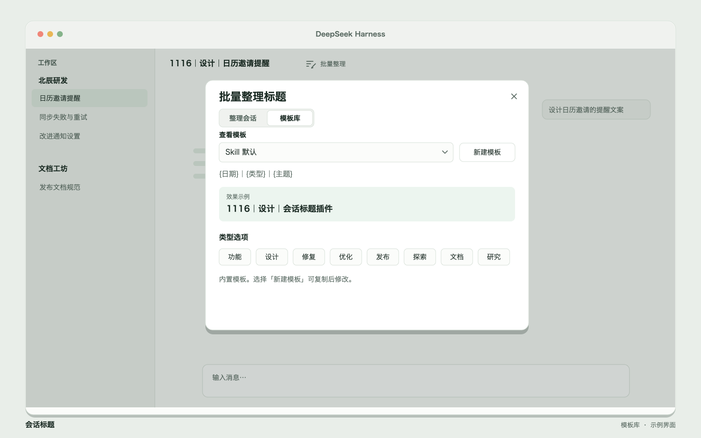
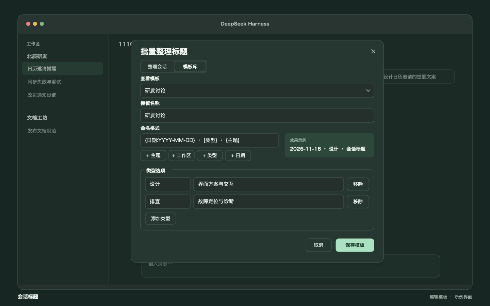

# 会话标题 · DSH Conversation Titles


为 DeepSeek Harness 整理会话标题。按当前工作区规则生成标题，批量整理未归档会话，并让多个工作区共用一套命名模板。

适配 **DSH 0.2.2-rc.3**。 [详细使用说明](docs/usage.md) · [English](README.en.md)



## 安装

安装后从任一会话顶栏进入 **批量整理**。已有本地链接开发版时，继续用该链接即可。

**从 npm 安装到 Desktop profile**

```sh
dsh plugin --profile desktop add dsh-conversation-title --registry=https://registry.npmjs.org
```

如果终端找不到 `dsh`，macOS 上可使用 Desktop 的内置 CLI：

```sh
"/Applications/DeepSeek Harness.app/Contents/Resources/runtime/cli/bin/dsh" plugin --profile desktop add dsh-conversation-title --registry=https://registry.npmjs.org
```

安装完成后重新打开 DSH。使用其他 profile 时，把 `desktop` 换成对应名称。也可以使用 [GitHub 源码](https://github.com/xiaomao361/dsh-conversation-title) 安装。

<details>
<summary>本地链接与打包安装</summary>

在本仓库运行 `npm ci`，再使用绝对路径注册本地包：

```sh
dsh plugin --profile desktop add "link:$(pwd)"
```

分发压缩包时，在仓库运行 `npm pack`，再执行：

```sh
dsh plugin --profile desktop add "/path/to/dsh-conversation-title-0.3.1.tgz"
```

</details>

## 开始使用

1. **日常对话**。自动整理默认开启。助手在完成有明确主题的任务时会尝试按工作区模板拟题，默认格式为 `MMDD｜类型｜主题`。
2. **历史会话**。在顶栏点「批量整理」，确认当前、其他或全部工作区，再点「一键整理」。在本次结果面板里可以查看改名前后与撤销。
3. **模板库**。选择「Skill 默认」可查看内置格式和八种类型。以任意模板为起点新建并命名。在「整理会话」中选择工作区，应用已保存的模板。

| 模板库 | 编辑模板 |
| --- | --- |
|  |  |

配图以示例工作区和标题复现插件界面。

## 开发

```sh
npm ci
npm run check
npm test
npm pack --dry-run
```

维护市场资料时更新根目录的 `screenshots.json`。DSH 界面图标使用 `icon.svg`，公开卡片也可使用 [512 × 512 PNG](assets/icon-512.png)。

[CC0 1.0 Universal](LICENSE)
